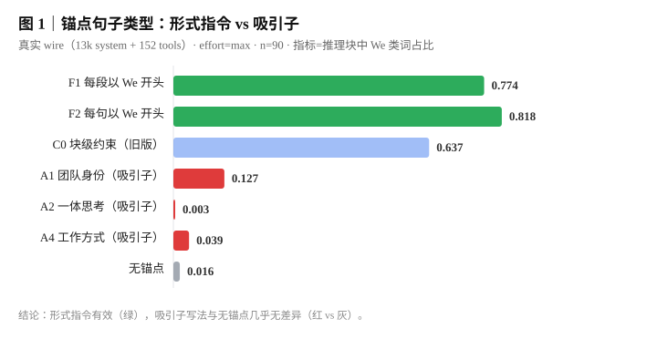
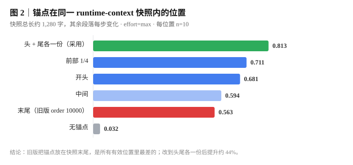
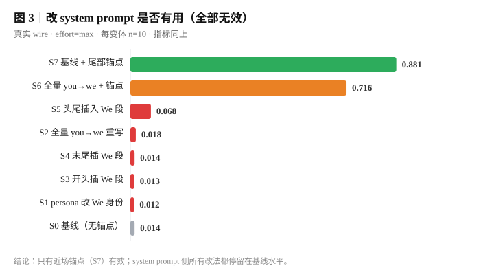
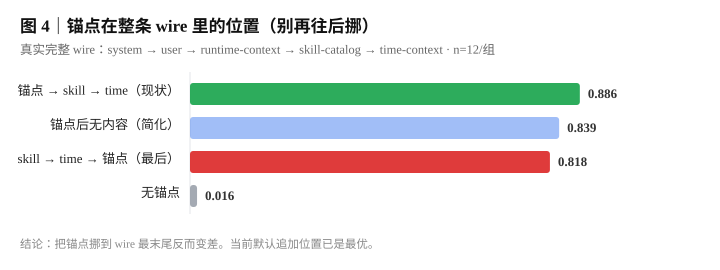
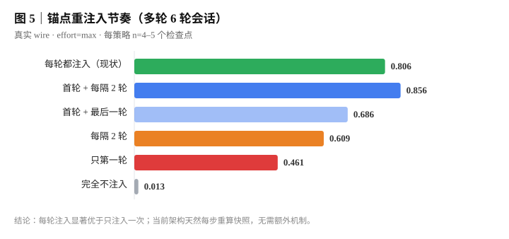
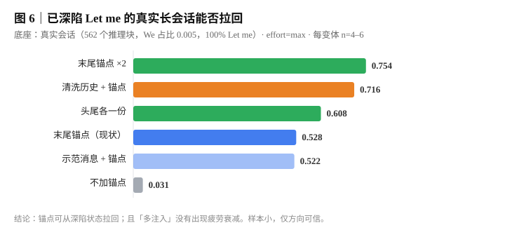
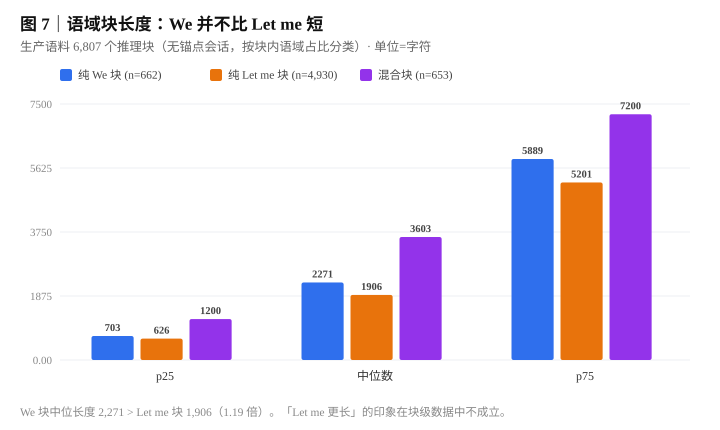
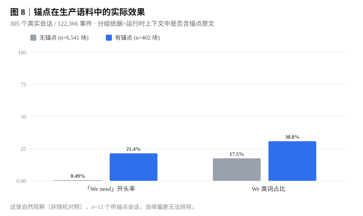

# 风插 · 推理语域锚定预设（Fengcha Register Anchor）

> **一句话定性：这是一个「硬指令约束」方案，不是「找到了能直接实现思维链的吸引子」。**
>
> 它做且只做一件事：通过形式化的段落级约束，让模型的推理过程更多使用第一人称复数
> （`We need` / `We should` / `Our`），从而**增多 `We need` 风格思维链的数量**。
>
> **本方案是否带来实际能力提升，目前没有证据；是否带来负面作用，目前也没有证据。**
> 详见 [§5 效果声明](#5-效果声明)。

---

## 1. 这是什么 / 不是什么

### 是

- 一个 DSH（DeepSeek Harness）**agent preset**，通过在运行时上下文（runtime-context）
  快照的头尾各注入一条形式化约束文本，影响模型 reasoning 的开头语域。
- 一个**可回退、作用域严格限定在 preset 内**的安装包：不选这个预设就完全不受影响。
- 一套**可复现的实测数据**：8 张图，来自 305 个真实会话 + 2000+ 次受控 API 调用。

### 不是

- ❌ 不是 prompt 优化技巧合集
- ❌ 不是「让模型变聪明」的方案
- ❌ 不是找到了某种可直接催生特定思维链的"吸引子"

**为什么特别强调"不是吸引子"：** 我们真的试过吸引子写法（描述"我们是一个团队、一体思考、
没有旁观者"这类身份叙事），并且**用真实 wire 做了对照实验**——结果是吸引子写法与
完全没有锚点在统计上没有差别（We 占比 0.057 vs 0.016），而形式指令（"每段必须以 We 开头"）
是 0.796。**在这个模型上，只有可检查的形式约束生效，身份叙事不生效。**

---

## 2. 安装

### 前置

- DSH Desktop（DeepSeek Harness），profile 目录通常在 `~/.dsh/profiles/desktop/`
- 本仓库位于任意本地路径，下文以 `./we-need` 为例

### 方式 A：link 安装（推荐，可随时改代码）

在 profile 的 `package.json` 中加入依赖与 bundle：

```jsonc
{
  "dependencies": {
    "dsh-fengcha": "link:./we-need"
  },
  "dsh": {
    "profile": {
      "bundles": [
        // ……其他 bundle……
        "dsh-fengcha"
      ]
    }
  }
}
```

然后建符号链接（Windows 需管理员或开发者模式）：

```bash
# 目标目录：~/.dsh/profiles/desktop/node_modules/@local/
# 链接指向：./we-need
mklink /D "C:\Users\<你>\.dsh\profiles\desktop\node_modules\@local\dsh-we-need" "<repo-root>\we-need"
```

或用 DSH 自带插件管理器（若可用）：

```
plugin_manager install_bundle target=<repo-root>\we-need
```

### 方式 B：直接放进 profile

把整个 `we-need/` 目录复制到 `~/.dsh/profiles/desktop/node_modules/dsh-fengcha/`，
同样在 `package.json` 里声明依赖（用 `"file:"` 或版本号）与 bundle。

### 生效与验证

1. **重启 DSH**（patch 在启动时由 loader 读取）
2. **新开一个会话**（预设是会话创建时选择的，已开会话不受影响）
3. 在预设列表中选择「**风插标准**」或「**风插 PTC**」
4. 验证：随便问一个问题，展开「思考」区块，看 reasoning 是否以 `We need` 开头

### 回退

```bash
cd ./we-need
cp archive/cordis.patch.yml.bak-before-headtail cordis.patch.yml
```

> 该备份是**改为头尾双锚点之前**的版本（单锚点、仅尾部）。
> 若想完全移除：从 profile 的 `bundles` 数组和 `dependencies` 中删除 `dsh-fengcha`，
> 删除对应 junction/符号链接，重启即可。

### 作用域保证（为什么不会污染其他预设）

| 机制 | 说明 |
|---|---|
| 插件挂在 **preset 内部** | `dsh-fengcha` 只出现在 `fengcha-route` / `fengcha-ptc` 两个 preset 的 `plugins` 列表里 |
| 通过 `ctx.systemPrompt.context()` 注册 | 该 API 注册在**挂载作用域**（即 preset 的 scope）内，不是全局 |
| 不修改任何全局配置 | 不改 `cordis.yml`、不改其他 preset、不改 DSH 源码 |
| slot 名按 preset 隔离 | `anchor:route:*` / `anchor:ptc:*` 前缀不同，避免同进程多预设挂载时在合并层冲突 |

**不选这两个预设 → 零影响。** 这是结构性保证，不是靠自觉。

---

## 3. 两个预设怎么选

| | **风插标准** | **风插 PTC** |
|---|---|---|
| preset id | `fengcha-route` | `fengcha-ptc` |
| 能力基底 | 官方 `standard` 预设的完整克隆 | 官方 `ptc` 预设的完整克隆 |
| 适合场景 | 日常编码、文件操作、多步任务、需要 plan mode | 长链路工具编排、多子任务、programmatic tool calling |
| 锚点配置 | 完全一致（头尾各一份） | 完全一致 |
| 插件条目数 | 20 顶层 + 13 嵌套 | 24 顶层 + 10 嵌套 |

**两者唯一的差异是能力基底，锚点效果完全相同。** 选哪个取决于你平时用 standard 还是 ptc。

> ⚠️ **克隆漂移提醒**：两个预设都是从**当前 DSH 编译后的 `cordis.yml`** 提取的官方配置。
> DSH 升级后官方 preset 可能变化，届时需重新生成（见 `build-presets.mjs`）。
> 历史教训：早期版本从旧 patch 克隆，漏掉了 `tool-subagent-codex`、`tool-subagent-claude-code`、
> `tool-ralph` 三个插件，直到逐条比对才发现。

---

## 4. 核心机制与数据

### 4.1 注入的是什么

一条文本，在 runtime-context 快照的**头（order 1）**和**尾（order 10000）**各注册一次：

```
We open every reasoning block with "We need". The whole block stays in the first-person
plural: We, Our, Let's. We never write "Let me", "I", "I'll", "I've", or "my" anywhere
inside a reasoning block. Every paragraph must begin with "We" or "Our". This holds for
inspection work too: when we read, diagnose, or verify, we say "We need to check"
rather than "Let me check".
```

关键设计（每条都有对照实验支撑）：

| 设计点 | 结论 | 证据 |
|---|---|---|
| 句式 | 形式指令（"每段必须以 We 开头"）有效，身份叙事（"我们是团队"）无效 | 图 1 |
| 粒度 | 段落级 > 块级。块级约束在长思考中不可执行 | 图 1 |
| 位置 | 快照头尾各一份 > 仅开头 > 中间 > 仅末尾（旧版最差） | 图 2 |
| system prompt | 改 persona / 全量 you→we / 头尾插段，全部无效 | 图 3 |
| wire 层位置 | 不要挪到 skill/time 之后，默认追加位置已最优 | 图 4 |
| 重注入 | 每轮注入 >> 只注入一次；当前架构天然每步重算快照 | 图 5 |

### 4.2 图 1｜句子类型：形式指令 vs 吸引子



- **F1/F2（形式指令）**：0.774 / 0.818
- **A1/A2/A4（吸引子）**：0.127 / 0.003 / 0.039 —— 与无锚点（0.016）无统计差别
- **C0（旧版块级约束）**：0.637

> 这是本方案最核心的定性依据：**为什么是硬指令而不是找到吸引子。**

### 4.3 图 2｜快照内部位置



| 位置 | 均 We 占比 |
|---|---|
| 头 + 尾各一份 | **0.813** |
| 前部 1/4 | 0.711 |
| 开头 | 0.681 |
| 中间 | 0.594 |
| 末尾（旧版） | 0.563 |
| 无锚点 | 0.032 |

**为什么单锚点不够：** runtime-context 快照每个 step 都会重新渲染，里面的其他段落
（sandbox 策略、审批策略、记忆注入、engram 等）一直在变。单个尾部锚点被埋在
一两千字的变动内容之后，注意力被稀释。

### 4.4 图 3｜改 system prompt 为什么没用



我们试了 6 种 system prompt 侧改法，**全部停留在基线水平**（0.012–0.068 vs 基线 0.014）：

- S1 persona 改成 "We are a coding team"
- S2 全量把 you/your 重写成 we/our（8 处）
- S3/S4/S5 在 system 开头/结尾/头尾插入 We 身份段

而同样的锚点放到近场 runtime-context（S7）→ 0.881。

**结论：system prompt 的位置和措辞对语域几乎零影响。位置比内容重要一个数量级。**

### 4.5 图 4｜wire 层位置（反直觉）



| wire 结构 | 均 We 占比 |
|---|---|
| 锚点 → skill-catalog → time-context（现状） | **0.886** |
| skill-catalog → time-context → 锚点（挪到最后） | 0.818 |
| 无锚点 | 0.016 |

**把锚点挪到 wire 最末尾反而更差。** 直觉上"离用户消息越近越好"在这里不成立。

### 4.6 图 5｜重注入节奏



| 策略 | 均 We 占比 |
|---|---|
| 每轮都注入（现状） | **0.806** |
| 首轮 + 每隔 2 轮 | 0.856（但逐轮波动大，n 小不可信） |
| 每隔 2 轮 | 0.609 |
| 只第一轮 | 0.461 |
| 完全不注入 | 0.013 |

当前架构中 runtime-context 快照每 step 重算，天然就是"每轮注入"，无需额外机制。

### 4.7 图 6｜已深陷 `Let me` 的长会话能否拉回



底座是真实会话（562 个推理块，We 占比 0.005，100% Let me）。加锚点后：
0.031 → 0.528（单条）→ 0.754（两条）。

**同时否掉了一个假设**：不存在"重复多了被当背景噪音忽略"的疲劳效应——加得更多反而更强。

### 4.8 图 7｜语域块长度（修正一个常见误解）



| 块类型 | n | p25 | 中位 | p75 |
|---|---|---|---|---|
| 纯 We 块 | 662 | 703 | **2,271** | 5,889 |
| 纯 Let me 块 | 4,930 | 626 | **1,906** | 5,201 |
| 混合块 | 653 | 1,200 | 3,603 | 7,200 |

**We 块中位长度 2,271 > Let me 块 1,906（1.19 倍）。**
"Let me 思维链比 We need 长"的印象，在块级数据中**不成立**。详见 §7 机制澄清。

### 4.9 图 8｜生产语料中的实际效果（自然观察，非随机对照）



| 分组 | 会话数 | 推理块 | 「We need」开头率 | We 类词占比 |
|---|---|---|---|---|
| 含锚点 | 12 | 402 | **21.4%** | 30.8% |
| 不含锚点 | 281 | 6,541 | 0.49% | 17.5% |
| 同 cwd 对照 | 62 | 1,276 | **0%** | 4% |

> ⚠️ **这是自然观察，不是 RCT。** n=12 个带锚点会话，全部来自同一天、同一模型、
> 同一 provider，任务选择非随机。效应量大且方向一致，但**不能当作因果结论**。

---

## 5. 效果声明

**必须原样理解以下三句话：**

1. **本方案只是增多 `We need` 风格思维链的出现频率。**
   实测：受控条件下 We 占比从 0.016（无锚点）提升到 0.813（头尾双锚点）。

2. **暂不明确是否有实际效果提升。**
   我们没有做能力基准测试，也没有在受控条件下测量任务完成率、正确率、
   代码质量或任何下游指标。**"推理语域变了"与"模型变强了"之间没有建立任何联系。**

3. **暂不明确是否存在负面作用。**
   没有测量：token 消耗变化、延迟变化、长上下文下的副作用、
   特定任务类型（如需要细致排查的诊断类任务）是否被语域约束伤害。
   形式指令确实会在 reasoning 中留下**元格式痕迹**（模型会思考"这段要以 We 开头"），
   这部分注意力开销的代价未被量化。

**如果你看到有人声称"这个方案让模型变强了"，那是超出本仓库证据范围的推断，不应采信。**

---

## 6. 语域行为说明（已观测）

### 6.1 两种语域的实证画像

| 维度 | `We` 类块 | `Let me` 类块 |
|---|---|---|
| 占全部推理块 | 约 10% | 约 75% |
| 中位长度 | 2,271 字符 | 1,906 字符 |
| 含代码块 | 39.1% | 15.7% |
| 含问号 | 76.2% | 62.3% |
| 含 `I'll / I'm going to` | 4.8% | **97.7%** |
| 其后 3 步内工具调用数 | 3.21 | 5.89 |

### 6.2 可稳定观测的规律

1. **语域在块开头就锁定。** 只看块首 40 字符预测整块语域，准确率 **98.9%**。
2. **块内不自发漂移。** 块首 1/3 → 块中 1/3 → 块尾 1/3 的 We 占比：
   0.119 → 0.112 → 0.106（几乎不动）。
3. **块间转移不对称。** `We → Let me` 频率 8.6%，`Let me → We` 频率 1.05%，
   **约 8 倍不对称**。这是"掉下去回不来"体感的来源。
4. **同一任务重复多次，语域高度确定。** 同题重复 6 次，任务级纯度可达 100%。
   **语域不是随机抖动，是任务性质决定的。**
5. **任务类型本身在推语域。** 建/写类任务偏 `Let me`，读/查类任务偏 `We`。
   这是独立于锚点的第二个驱动力（见 §7）。

### 6.3 一个必须说清的边界

生产语料中只有 **10 个会话**以 `We` 开头，样本极少。
因此"会话内语域演化"层面的结论（包括"第 N 块之后是否衰减"）统计上很弱。
**块级结论（6,807 个块）是稳的，会话级不牢。**

---

## 7. 机制澄清

### 7.1 「模型训练出的 SFT 效果是 we 负责重规划、let me 负责重执行」——**不完全成立**

我们**没有**模型训练数据、SFT 配方或内部文档，无法对训练阶段做任何断言。
**以下全部是基于推理文本行为的观测，不是对训练目标的推断。**

从观测数据能支持的表述是：

- **`Let me` 更像执行态**：97.7% 含第一人称即时动作（`I'll` / `I'm going to`），
  其后平均跟 5.89 次工具调用（`We` 块 3.21 次）。这一条证据较强。
- **`We` 不能简单叫"规划态"**：它出现在代码块更多（39.1% vs 15.7%）、
  问号更多（76.2% vs 62.3%）的地方。更准确的描述是
  **"这件事还需要先盘清楚"** 的场合——待确认、待核对、有待解的问题。
  它常出现在动手之前，但这不等于它"属于规划阶段"。

> **（待补充）** 要把"规划 / 执行"这个二分坐实，需要按动作类型对推理片段做细粒度标注
> （例如标记"陈述计划""调用工具""核对结果"），并检验语域与动作类型的条件独立性。
> 本仓库没有做这个标注。

### 7.2 「为什么 let me 的思维链普遍比 we need 长」——**这个前提在块级数据中不成立**

| | 中位长度 | p25 | p75 |
|---|---|---|---|
| 纯 `We` 块 | **2,271** | 703 | 5,889 |
| 纯 `Let me` 块 | **1,906** | 626 | 5,201 |

**`We` 块反而更长 1.19 倍。** 所以"Let me 更长"这个印象需要修正。

可能导致该印象的来源（均为推测，未验证）：

- **会话级差异被误读为块级差异**：长会话里 `Let me` 块数量占绝对多数（5,136 vs 693），
  容易给人"Let me 主导了长思考"的印象。
- **混合块最长**（中位 3,603，p75 7,200）：语域来回切换的块通常是最长、最费劲的那类，
  但这些块在直觉上可能被归入"Let me 的思考"。
- **单次会话内的观感**：一次具体任务里看到很长的 `Let me` 推理，比统计中位数更容易被记住。

> **（待补充）** 需要在**同一任务**内控制任务难度后比较两种语域的长度，
> 才能判断是否存在"语域 → 长度"的因果效应。现有数据只能说明总体分布。

### 7.3 「这是基于任务语义切换导致的」——**方向正确，但机制未确认**

**目前能支持的，是"任务形式与语域相关"这一关联性结论：**

- 固定 persona，改变任务形式，语域分布显著改变（建/写类偏 `Let me`，读/查类偏 `We`）。
- 同一任务重复多次，语域高度确定（任务级纯度可达 100%）——说明主要由任务性质决定，
  不是随机。
- 早期实验曾观察到"会话内 Δ(build − inspect) = +0.42"，支持任务形式会影响语域。

**但这不等于"模型在做任务语义分类然后路由"。** 以下均未验证：

- 是否存在一个显式的语义分类步骤？
- "任务语义"的哪个维度在起作用（动作类型？信息结构？token 级上下文？）？
- 相关性是否由第三因素（如任务所需的工具调用密度、上下文长度）共同驱动？
- 切换是否可预测（给定任务文本，能否事先预判语域）？

> **（待补充）** 要坐实"语义路由"，需要：
> ① 构造只在语义维度上变化、其余全部对齐的任务对；
> ② 测量切换是否发生在 token 级可定位的位置；
> ③ 排除工具密度、上下文长度等混淆变量。
> 本仓库只做到了 ① 的初步版本（build/inspect 对照），且样本量不足以支撑强结论。

### 7.4 关于"锚点能否让模型回到 We"——做了修正

早期基于生产语料曾得出"`We → Let me` 是棘轮，回不去"的结论。
后续在**真实长会话底座**上重测发现：**加锚点能把模型从深陷的 `Let me` 拉回**（0.031 → 0.528）。

差异原因：早期结论来自**锚点不重注入**的条件；后者是**每轮重注入**的条件。

**这提示：早期"棘轮"结论只在特定注入条件下成立，不应泛化为模型的内在性质。**

---

## 8. 已知限制

1. **样本量偏小。** 位置类实验每组 n=10；真实底座实验 n=4–6。
   **方向可信，精确数值不可外推。**
2. **单一模型。** 全部实验在 `deepseek-v4.1-flash`（经 d1 中转）上完成。
   未验证其他模型（v4-pro、glm、kimi 等）是否同样适用。
3. **受控实验用真实 wire，但非真实工具往返。** 实验中提供了真实 system prompt
   （13k）和真实工具 schema（152 个），但没有真实的工具调用结果回流。
   真实 DSH 会话中工具结果会持续污染上下文，效果可能不同。
4. **生产语料的对比是自然观察。** 12 个带锚点会话 vs 281 个对照，非随机分配，
   单一时间窗、单一 provider，选择偏差无法排除。
5. **纯文本工具。** 没有测量：多模态输入、代码仓库级大规模编辑、长时间
   （>100 轮）会话下的表现。
6. **未测能力。** 完全没有测任务正确率、代码质量、延迟、token 成本变化。
7. **提示词缓存。** 锚点作为常量文本注册，头部/尾部各一次。
   实测对缓存命中影响极小（约 15 token 额外计算，命中率 99.4%），
   但若你的 provider 缓存策略不同，需自行验证。

---

## 9. 复现

### 9.1 实验脚本

所有实验脚本在 `capbench/route/` 下，需要 d1 通道的 key（脚本内硬编码，**请自行替换**）。

| 脚本 | 对应图表 | 说明 |
|---|---|---|
| `sentence-ablation.mjs` / `ablation-realwire.mjs` | 图 1 | 句子类型消融（形式 vs 吸引子） |
| `snapshot-position.mjs` | 图 2 | 快照内部位置 |
| `sys-ablation.mjs` | 图 3 | system prompt 侧消融 |
| `real-wire-position.mjs` | 图 4 | wire 层位置 |
| `reinject-cadence.mjs` | 图 5 | 重注入节奏 |
| `real-base-anchor.mjs` | 图 6 | 真实 Let-me 底座拉回 |
| `length-register.mjs` / `pick-base-sessions.mjs` | 图 7 | 语域与长度关系 |
| `lang-switch.mjs` / `lang-midswitch.mjs` | — | 语言切换诊断（附录） |

生成图表：

```bash
cd <repo-root>
node scripts/make-charts.mjs      # 输出到 charts/*.svg
```

### 9.2 重建预设

DSH 升级后，官方 preset 可能变化。重新从编译后的配置生成：

```bash
cd ./we-need
node build-presets.mjs    # 从 ~/.dsh/profiles/desktop/cordis.yml 提取并校验
```

脚本会逐条比对官方插件集合，报告缺失项。

### 9.3 关键实验参数（统一）

- model: `deepseek-v4.1-flash`（d1 中转）
- reasoning_effort: `max`（除注明外）
- 并发: 100
- wire: 真实 13,099 字符 system prompt + 152 个真实工具 schema
- 指标: `We`/`Our`/`Us`/`Let's` 计数 ÷（集体 + 个体）计数，剥离代码块与引号内容
- 分类阈值: ≥0.85 为纯 We，≤0.15 为纯 Let me

---

## 附录 A：非目标用途

本仓库**不适合**：

- 作为"提升模型能力"的方案推广
- 作为 prompt engineering 最佳实践
- 与其他"越狱 / 越权"类方案类比

## 附录 B：术语

- **语域（register）**：推理文本使用的人称形式。本文分 `We` 类（第一人称复数）与
  `Let me` 类（第一人称单数）。
- **锚点（anchor）**：注入到运行时上下文中、试图影响语域的文本。
- **吸引子（attractor）**：通过描述身份/状态来"自然"引出某种行为的写法（本项目证伪）。
- **形式指令（formal directive）**：规定可检查输出形状的指令（如"每段必须以 We 开头"）。

## 附录 C：许可

（待定）

## 附录 D：致谢与声明

本项目的负面结论（哪些方向**不可行**）与正面结论同样重要。已明确证伪的方向：

- 身份叙事 / 吸引子写法
- system prompt 侧的任何改动
- 把锚点挪到 wire 更后面
- 更高频率的重注入（已经天然是每步）

这些结论可能比他人在别处看到的"成功案例"更有参考价值：**它们都带着对照数据。**
